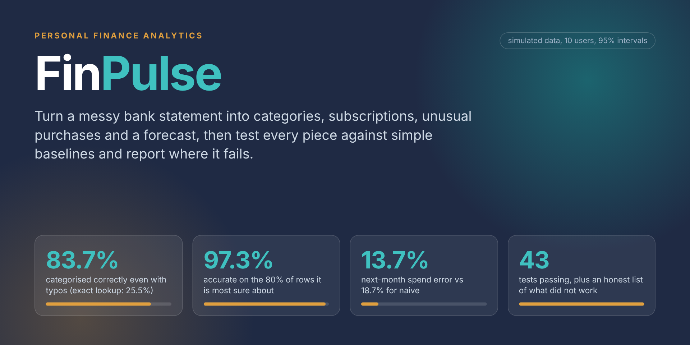
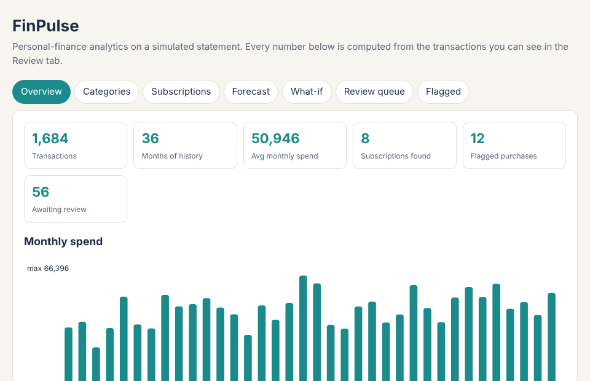
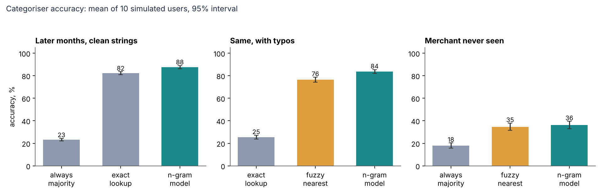
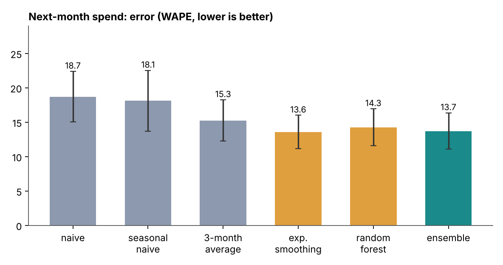

<p align="center"></p>

# FinPulse

**Personal-finance analytics with an evaluation you can trust.** FinPulse turns a messy bank statement into categories, subscriptions, unusual purchases, a next-month forecast and a what-if savings plan. Then it tests each piece against simple baselines on ten different simulated users and reports where it does not work.

   

<p align="center"></p>

<sub>The dashboard is one HTML file generated by `python -m finpulse demo`.</sub>

> **All data here is simulated.** There is no real bank data in this repository. The simulator keeps the answers (true merchants, which rows recur, which purchases were made unusually large) in a separate table that no analysis stage can read. To try it on real data, see [Use your own statement](#use-your-own-statement); it never leaves your machine.

## What it does

| Piece | Method | Compared against |
|---|---|---|
| Categorise transactions | Character n-gram TF-IDF + logistic regression, with a confidence score | Exact-match lookup, fuzzy nearest neighbour, always-majority |
| Review queue | Least-confident rows are sent to a person; corrections are learned | Random sampling (active learning) |
| Subscriptions | Timing (about monthly) and amount stability, no labels used | Injected ground truth |
| Unusual purchases | Robust z-score inside each category | One global z-score |
| Forecast next month | Ensemble of average, exponential smoothing and random forest, with an 80% band | Naive, seasonal naive, 3-month average |
| What-if savings, budget risk | Cut a % from discretionary spend; chance of overspend from past forecast errors | Arithmetic checked in tests |
| Storage | SQLite with SQL views; the SQL totals match pandas (tested) | |

## Results

Ten simulated users (different random draws), mean with 95% interval. Test months come after training months, so some merchants are new.



- **Typos:** with misspelt descriptions the model keeps 83.7% (interval 81.9 to 85.4) while exact lookup collapses to 25.5%. A fuzzy nearest-neighbour matcher gets 76.4%, so the model is 7.2 points better (interval 5.7 to 8.8).
- **Clean strings:** 87.6% against 82.2% for lookup, a 5.4-point gain (3.6 to 7.1). Always guessing the biggest category gives 23.2%.
- **Confidence works:** keep only the 80% most confident predictions and accuracy is 97.3%; the rest go to review.
- **Unseen merchants are the weak spot.** About 21% of test rows come from merchants never seen in training. On those rows the model gets only 52.4% (46.5 to 58.2). When every test merchant is held out, it reaches 36.2%, better than guessing (18.0%) but not good. A model cannot know that an unfamiliar name is a pharmacy without a clue in the name.
- **Active learning did not help.** Picking the least-confident rows to label was *worse* than random until the labelling budget was large (70.7% against 80.8% at 180 labels). We report it because we expected the opposite.
- **Subscriptions:** found all of them with no false alarms (precision and recall 100% on every user). This is the easiest task here because the simulated payments are exactly regular; real statements will be harder.
- **Unusual purchases:** with a normal worked out per category, the detector finds 69% of injected anomalies (60 to 78) with 79% of flags correct. A single global normal finds 4%. The gap is 65 F1 points (50 to 80).
- **Forecast:** the ensemble's error (WAPE) is 13.7%, against 18.7% for naive and 18.1% for seasonal naive. It beats the 3-month average by 1.5 points (0.5 to 2.5). Exponential smoothing alone is as good (13.6%). The random forest alone is not clearly better than the plain average (difference interval -2.6 to 0.6).
- **The 80% band is not 80%.** It held 72% of the time (64 to 81) and is wide (43% of the typical month). We say so on the dashboard.



### The simulator's biggest assumption

How many merchants have a descriptive name (CITY PHARMACY) rather than a brand (APOLLO) changes how hard unseen merchants are. We tested 0%, 35% and 70%. The model beat lookup on unseen merchants at every setting (34%, 39%, 35% against about 25%), so the conclusion holds, but the absolute numbers depend on this choice. See [docs/DATA_CARD.md](docs/DATA_CARD.md).

## Run it

```bash
git clone https://github.com/Pranjaltomar07/FinPulse.git && cd FinPulse
pip install -r requirements.txt
python -m pytest                    # 43 tests, about 10 seconds
python -m finpulse demo             # builds output/dashboard.html and output/finpulse.db
python -m finpulse evaluate         # the 10-user evaluation, about 1 minute; rewrites results/ and docs/img/
```

Open `output/dashboard.html` in any browser. No server, no internet needed.

## Use your own statement

```bash
python -m finpulse analyze --csv my_statement.csv --date-col Date --desc-col Narration \
       --debit-col Withdrawal --credit-col Deposit
```

Use `--amount-col` instead if amounts are signed. If the file has no categories, keyword rules label what they can and the model learns from those. **That cold-start path is tested only on simulated data**, so expect to correct the review queue. Remove names and account numbers first, and do not commit the file.

## Layout

```
src/finpulse/   simulate, clean, ingest, rules, categorize, recurring, anomaly, forecast, budget, warehouse, pipeline, dashboard, evaluate
tests/          43 tests
results/        per_user.csv, summary.csv, sensitivity.csv, anomaly_sweep.csv
docs/           FINDINGS.md, DATA_CARD.md, ARCHITECTURE.md, img/
data/           sample_statement.csv (a few simulated rows to show the input format)
```

## Limits

Simulated data; one currency and one bank-style format; the strings are synthetic, so real statements will be messier; no real user study; the anomaly threshold (z above 4) was picked on one simulated user, then fixed before the ten-user run; the forecast has 36 months of history at most.

## How it was built

I designed, coded and implemented FinPulse in Python, and used GenAI tools as an assistant for drafting and debugging. I then tested and validated the work myself:

- 43 automated tests (simulator determinism, cleaning, ingestion, every detector, forecast arithmetic, SQL views).
- Every number in this README is reproduced by `python -m finpulse evaluate` and stored in `results/`.
- SQL totals are cross-checked against pandas, and the hidden ground-truth table is kept out of every analysis stage.
- Results that disappointed (unseen merchants, active learning, forecast band) are reported, not hidden.

## Author

Pranjal Tomar ([@Pranjaltomar07](https://github.com/Pranjaltomar07)), ORCID [0009-0004-6638-2424](https://orcid.org/0009-0004-6638-2424). MIT licence. If you use this, see `CITATION.cff`.
